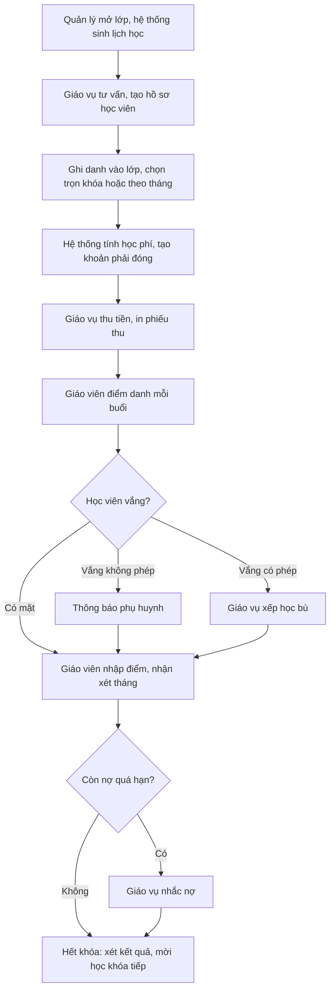
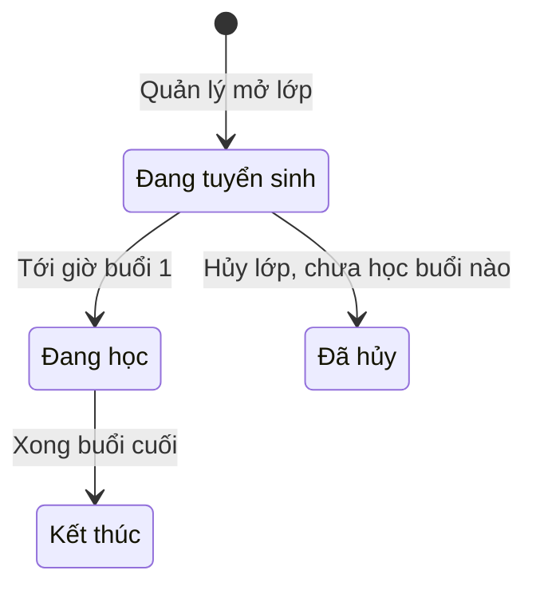
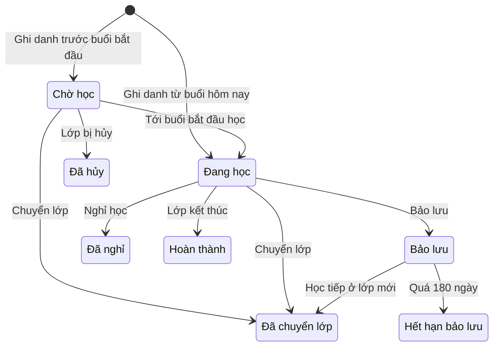
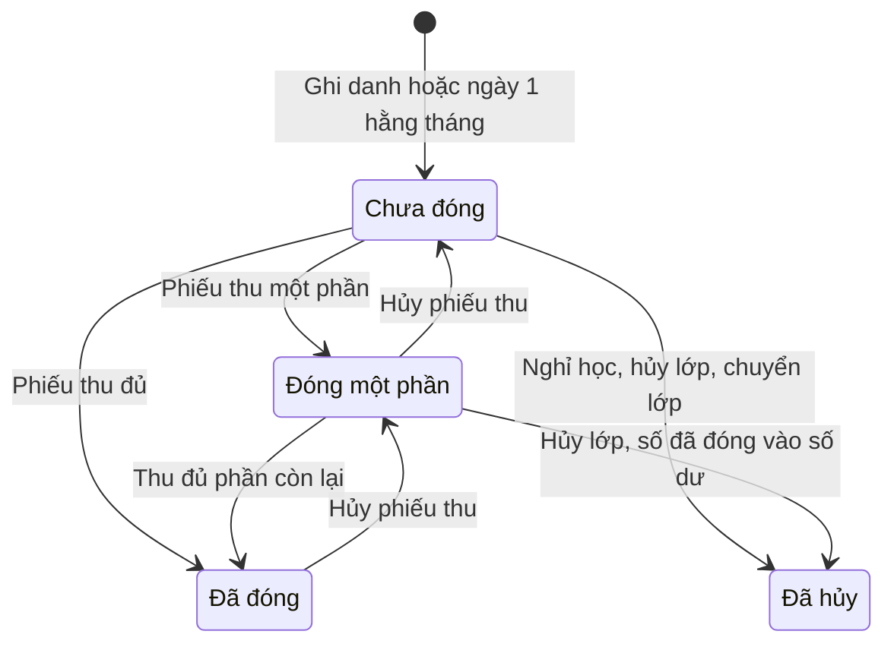

# Đặc tả yêu cầu phần mềm (SRS) — Quản lý Trung tâm Ngoại ngữ

| Phiên bản | Ngày | Trạng thái |
| :--- | :--- | :--- |
| 1.0 | 12/10/2026 | Bản nháp để triển khai demo |

> Cách viết, quy ước mã, mức độ chi tiết: `ZDOCS/05-HUONG-DAN/HUONG-DAN-VIET-TAI-LIEU-NGHIEP-VU.md`.
> Phần nền (đăng nhập, tài khoản, vai trò, cài đặt, đặt lại dữ liệu demo): `ZDOCS/03-KIEN-TRUC/USE-CASE-NEN.md`, không viết lại ở đây.

---

## 1. Giới thiệu

### 1.1. Mục đích

Tài liệu mô tả yêu cầu của bản demo Quản lý Trung tâm Ngoại ngữ: khóa học, lớp, lịch học, ghi danh, điểm danh, học bù, điểm và nhận xét, học phí, nhắc nợ, cổng phụ huynh và báo cáo. Dev dùng để code, tester dùng để viết và chạy test case, sales dùng để biết demo làm được gì.

### 1.2. Phạm vi

**Trong phạm vi:** khóa học và học phí; giáo viên, phòng học, ngày nghỉ của trung tâm; mở lớp, sinh lịch học, thời khóa biểu, điều chỉnh buổi; học viên, ghi danh, chuyển lớp, bảo lưu, nghỉ học; điểm danh trên điện thoại, thông báo vắng, xin nghỉ, học bù; điểm kiểm tra, nhận xét tháng, kết quả cuối khóa; khoản học phí theo khóa hoặc theo tháng, phiếu thu, công nợ, nhắc nợ; cổng phụ huynh; tổng quan và báo cáo.

**Ngoài phạm vi:** học trực tuyến, bài tập online, ngân hàng đề; gửi Zalo, SMS thật (chỉ giả lập); cổng thanh toán thật (QR giả lập); hoàn tiền học phí bằng tiền mặt; hóa đơn điện tử; tính lương giáo viên (chỉ có báo cáo giờ dạy); CRM tư vấn tuyển sinh, quảng cáo; nhiều cơ sở.

### 1.3. Thuật ngữ

| Thuật ngữ | Giải thích |
| :--- | :--- |
| Khóa học | Chương trình học có số buổi, thời lượng buổi, học phí cố định, vd "Tiếng Anh giao tiếp B1" 36 buổi |
| Lớp | Một lần mở khóa học với giáo viên, phòng, lịch cố định, vd `GT-B1-2609A` |
| Buổi học | Một lần lên lớp theo lịch, có số thứ tự từ 1 tới số buổi của khóa |
| Ngày nghỉ | Ngày trung tâm không dạy (lễ, Tết); buổi rơi vào ngày nghỉ được lùi ra sau |
| Học viên | Người học; dưới 18 tuổi phải có phụ huynh liên hệ |
| Phụ huynh | Người liên hệ của học viên; có thể có tài khoản cổng phụ huynh |
| Ghi danh | Việc xếp một học viên vào một lớp, kèm hình thức học phí và ưu đãi |
| Buổi bắt đầu học | Buổi đầu tiên học viên tham gia lớp; ghi danh giữa khóa thì sau buổi 1 |
| Số buổi tính phí | Số buổi từ buổi bắt đầu học tới buổi cuối của lớp |
| Học phí trọn khóa (F) | Học phí đóng một lần cho cả khóa |
| Học phí tháng (M) | Học phí mỗi tháng cho số buổi chuẩn S buổi/tháng; chỉ khóa có khai báo mới thu theo tháng |
| Khoản học phí | Một khoản phải đóng: trọn khóa, hoặc một tháng, hoặc khoản thu thêm khi chuyển lớp |
| Ưu đãi | Giảm học phí theo danh mục: anh chị em ruột, học viên cũ |
| Phiếu thu | Một lần nhận tiền của một học viên, phân bổ vào một hoặc nhiều khoản |
| Số dư | Tiền học viên đã đóng thừa hoặc được chuyển từ lớp cũ, trừ vào khoản sau |
| Công nợ | Tổng còn phải đóng của các khoản chưa đóng đủ |
| Quá hạn | Khoản đã qua hạn đóng mà còn nợ |
| Điểm danh | Ghi trạng thái từng học viên trong một buổi: Có mặt, Đi muộn, Vắng có phép, Vắng không phép |
| Chuyên cần | Tỉ lệ buổi học viên có học so với số buổi đã diễn ra (BR-16) |
| Học bù | Học viên vắng có phép học buổi tương ứng ở lớp khác cùng khóa |
| Bảo lưu | Học viên tạm dừng, giữ giá trị học phí của các buổi chưa học trong thời hạn cho phép |
| Chuyển lớp | Học viên chuyển sang lớp khác cùng hoặc khác khóa |
| Nhận xét tháng | Đánh giá định kỳ của giáo viên theo 5 tiêu chí kèm lời nhận xét |
| Tin nhắn giả lập | Nội dung Zalo/SMS hệ thống tạo, lưu và hiển thị trên cổng phụ huynh, không gửi thật |
| Thực thu | Tổng tiền các phiếu thu hợp lệ, không gồm phiếu thu đã hủy |

### 1.4. Tài liệu liên quan

| Tài liệu | Nội dung |
| :--- | :--- |
| `01-TONG-QUAN-NGHIEP-VU.md` | Tổng quan nghiệp vụ |
| `03-USE-CASE.md` | Đặc tả use case |
| `05-KICH-BAN-KIEM-THU.md` | Test case nghiệm thu |
| `ZDOCS/03-KIEN-TRUC/USE-CASE-NEN.md` | Phần nền dùng chung |

---

## 2. Mô tả tổng quan

### 2.1. Bối cảnh sản phẩm

Trung tâm ngoại ngữ một cơ sở, 200–400 học viên, 6–10 phòng học, dạy tiếng Anh giao tiếp, IELTS, TOEIC, tiếng Anh thiếu nhi, tiếng Nhật, tiếng Hàn. Lớp học buổi tối ngày thường và cả ngày cuối tuần. Giáo vụ ngồi quầy tư vấn, ghi danh, thu học phí, gọi nhắc nợ. Giáo viên điểm danh, nhập điểm trên điện thoại ngay trong lớp. Phụ huynh xem lịch học, điểm danh, học phí của con trên điện thoại. Quản lý mở lớp, xếp lịch, theo dõi sĩ số, doanh thu, công nợ trên máy tính.

### 2.2. Tác nhân

| Mã vai trò | Tên | Thiết bị | Mục tiêu khi dùng hệ thống |
| :--- | :--- | :--- | :--- |
| `ADMIN` | Quản trị viên | Desktop | Cấu hình hệ thống, tài khoản, phân quyền |
| `MANAGER` | Quản lý | Desktop | Khóa học, mở lớp, xếp lịch, giáo viên, phòng; duyệt hủy phiếu thu; xem tổng quan, báo cáo |
| `STAFF` | Giáo vụ | Desktop | Ghi danh đúng lớp, tính đúng học phí, thu tiền, nhắc nợ, xử lý chuyển lớp, bảo lưu, học bù |
| `TEACHER` | Giáo viên | Điện thoại | Điểm danh nhanh, ghi bài tập, nhập điểm, nhận xét học viên lớp mình |
| `PARENT` | Phụ huynh | Điện thoại | Biết con có đi học không, học thế nào, còn nợ bao nhiêu học phí |
| — | Học viên | — | Không đăng nhập trong demo; học viên từ 18 tuổi muốn xem thông tin thì được cấp tài khoản vai trò `PARENT` gắn với chính mình |

Tài khoản demo: `admin`, `quanly`, `nhanvien` (Giáo vụ, vai trò `STAFF`), `giaovien` (gắn giáo viên `GV01` Nguyễn Thảo Vy), `phuhuynh` (gắn phụ huynh Trần Văn Hùng, có 2 con đang học).

### 2.3. Quy trình nghiệp vụ

### 2.4. Giả định và ràng buộc

- Một cơ sở; mỗi lớp một giáo viên chính và một phòng cố định; mỗi buổi có thể đổi phòng hoặc giáo viên dạy thay.
- Học phí là bội số của 1.000 ₫. Mọi khoản giảm và học phí theo tỉ lệ làm tròn xuống tới bội số 1.000 ₫.
- Thời khóa biểu theo tuần; mỗi lớp học 2–3 buổi/tuần vào các thứ cố định.
- Zalo, SMS là giả lập: hệ thống tạo nội dung tin, lưu nhật ký, hiển thị trên cổng phụ huynh, không gửi ra ngoài.
- QR chuyển khoản là ảnh giả lập theo định dạng VietQR; quẹt thẻ chỉ ghi nhận phương thức.
- Không hoàn tiền mặt: tiền dư khi chuyển lớp, hủy lớp được ghi vào số dư của học viên.
- In qua lệnh in của trình duyệt: phiếu thu khổ A5, phiếu kết quả học tập khổ A4.
- Dữ liệu học viên, phụ huynh trong demo là dữ liệu giả.

---

## 3. Yêu cầu chức năng

### 3.1. Tổng quan

| Mã | Yêu cầu | Ưu tiên | Vai trò | UC |
| :--- | :--- | :---: | :--- | :--- |
| FR-01 | Hệ thống hiển thị số học viên đang học, số lớp đang học, số buổi học hôm nay, thực thu tháng này, tổng nợ quá hạn, tỉ lệ chuyên cần 30 ngày | P1 | MANAGER, STAFF | UC-14 |
| FR-02 | Hệ thống hiển thị danh sách buổi học hôm nay (giờ, lớp, phòng, giáo viên, đã điểm danh hay chưa) và các lớp sắp khai giảng chưa đủ sĩ số tối thiểu | P2 | MANAGER, STAFF | UC-14 |

### 3.2. Khóa học, lớp, lịch học

| Mã | Yêu cầu | Ưu tiên | Vai trò | UC |
| :--- | :--- | :---: | :--- | :--- |
| FR-03 | Hệ thống cho phép quản lý thêm, sửa, ngừng khóa học: mã, tên, ngôn ngữ, trình độ, số buổi, thời lượng buổi, thang điểm (thang 10 hoặc band IELTS kèm band mục tiêu), học phí trọn khóa, học phí tháng và số buổi chuẩn mỗi tháng (nếu có), sĩ số tối thiểu và tối đa mặc định, mô tả | P1 | MANAGER | UC-01 |
| FR-04 | Hệ thống cho phép quản lý thêm, sửa, ngừng giáo viên (họ tên, số điện thoại, ngôn ngữ dạy, tài khoản đăng nhập gắn kèm) và phòng học (tên, sức chứa) | P1 | MANAGER | UC-02 |
| FR-05 | Hệ thống cho phép quản lý khai báo ngày nghỉ của trung tâm (ngày, tên, vd "Quốc khánh 2/9"); buổi học chưa diễn ra rơi vào ngày nghỉ tự lùi | P2 | MANAGER | UC-02 |
| FR-06 | Hệ thống cho phép quản lý mở lớp: chọn khóa học, giáo viên, phòng, các thứ trong tuần, giờ bắt đầu, ngày khai giảng, sĩ số tối thiểu và tối đa; hệ thống tự sinh mã lớp, sinh đủ buổi học và tính ngày kết thúc dự kiến | P1 | MANAGER | UC-03 |
| FR-07 | Hệ thống chặn mở lớp hoặc đổi lịch khi giáo viên hoặc phòng bị trùng giờ, hoặc sức chứa phòng nhỏ hơn sĩ số tối đa, và chỉ rõ buổi bị trùng | P1 | MANAGER | UC-03 |
| FR-08 | Hệ thống tự chuyển trạng thái lớp theo lịch (Đang tuyển sinh, Đang học, Kết thúc) và cho phép quản lý hủy lớp chưa học buổi nào | P1 | MANAGER | UC-03 |
| FR-09 | Hệ thống hiển thị thời khóa biểu tuần theo phòng hoặc theo giáo viên, bấm vào buổi để xem lớp | P2 | MANAGER, STAFF | UC-04 |
| FR-10 | Hệ thống cho phép dời ngày giờ một buổi, đổi phòng, đặt giáo viên dạy thay, hủy buổi và tự thêm buổi bù vào cuối lịch | P2 | MANAGER, STAFF | UC-04 |

### 3.3. Học viên, ghi danh

| Mã | Yêu cầu | Ưu tiên | Vai trò | UC |
| :--- | :--- | :---: | :--- | :--- |
| FR-11 | Hệ thống cho phép giáo vụ tìm học viên theo mã, họ tên, số điện thoại học viên hoặc phụ huynh; thêm, sửa hồ sơ: họ tên, ngày sinh, giới tính, số điện thoại, trường đang học, tối đa 2 phụ huynh (họ tên, quan hệ, số điện thoại), nguồn biết đến, ghi chú | P1 | STAFF | UC-05 |
| FR-12 | Hệ thống cảnh báo trùng học viên theo họ tên và ngày sinh, và gợi ý anh chị em khi trùng số điện thoại phụ huynh | P2 | STAFF | UC-05 |
| FR-13 | Hệ thống hiển thị hồ sơ học viên: các lớp đã và đang học, chuyên cần, điểm, nhận xét, khoản học phí, phiếu thu, số dư, lịch sử chuyển lớp, bảo lưu | P1 | STAFF | UC-05 |
| FR-14 | Hệ thống cho phép giáo vụ ghi danh học viên vào lớp còn chỗ: chọn buổi bắt đầu học, hình thức học phí (trọn khóa hoặc theo tháng), ưu đãi; hệ thống hiển thị cách tính học phí và tạo khoản phải đóng | P1 | STAFF | UC-06 |
| FR-15 | Hệ thống cho phép giáo vụ đăng ký học thử miễn phí một buổi cho học viên tiềm năng; học viên học thử hiện trong danh sách điểm danh buổi đó | P3 | STAFF | UC-16 |
| FR-16 | Hệ thống cho phép giáo vụ chuyển học viên sang lớp khác cùng hoặc khác khóa, hiển thị giá trị còn lại, học phí mới, chênh lệch trước khi xác nhận | P2 | STAFF | UC-07 |
| FR-17 | Hệ thống cho phép giáo vụ bảo lưu ghi danh trọn khóa, tính giá trị bảo lưu, hạn bảo lưu; học tiếp vào lớp cùng khóa trong thời hạn | P2 | STAFF | UC-07 |
| FR-18 | Hệ thống cho phép giáo vụ ghi nhận học viên nghỉ học từ một ngày, hủy các khoản tháng chưa tới hạn | P2 | STAFF | UC-07 |

### 3.4. Điểm danh, học bù

| Mã | Yêu cầu | Ưu tiên | Vai trò | UC |
| :--- | :--- | :---: | :--- | :--- |
| FR-19 | Hệ thống cho phép giáo viên mở buổi dạy hôm nay trên điện thoại, điểm danh từng học viên (mặc định Có mặt), ghi nội dung bài học, bài tập về nhà và lưu một lần | P1 | TEACHER | UC-08 |
| FR-20 | Hệ thống cho phép giáo vụ, quản lý sửa điểm danh sau thời hạn của giáo viên, bắt buộc nhập lý do | P2 | STAFF, MANAGER | UC-08 |
| FR-21 | Khi lưu điểm danh có học viên vắng không phép, hệ thống tạo thông báo giả lập gửi phụ huynh và hiển thị trên cổng phụ huynh | P2 | TEACHER | UC-08 |
| FR-22 | Hệ thống cho phép giáo vụ xếp học bù cho buổi vắng có phép vào buổi phù hợp của lớp khác cùng khóa | P2 | STAFF | UC-09 |

### 3.5. Điểm, nhận xét

| Mã | Yêu cầu | Ưu tiên | Vai trò | UC |
| :--- | :--- | :---: | :--- | :--- |
| FR-23 | Hệ thống cho phép giáo viên tạo bài kiểm tra (thường xuyên, giữa khóa, cuối khóa) và nhập điểm từng học viên theo thang điểm của khóa | P2 | TEACHER | UC-10 |
| FR-24 | Hệ thống cho phép giáo viên viết nhận xét tháng cho từng học viên theo 5 tiêu chí 1–5 sao kèm lời nhận xét, rồi gửi lên cổng phụ huynh | P2 | TEACHER | UC-10 |
| FR-25 | Hệ thống tính kết quả cuối khóa, xét Đạt hoặc Chưa đạt và in phiếu kết quả học tập khổ A4 | P2 | TEACHER, STAFF | UC-10 |

### 3.6. Học phí

| Mã | Yêu cầu | Ưu tiên | Vai trò | UC |
| :--- | :--- | :---: | :--- | :--- |
| FR-26 | Hệ thống hiển thị danh sách khoản học phí, lọc theo học viên, lớp, tháng, trạng thái, quá hạn | P1 | STAFF, MANAGER | UC-11 |
| FR-27 | Hệ thống tự tạo khoản học phí tháng vào ngày 1 hằng tháng cho mọi ghi danh theo tháng đang học | P1 | STAFF | UC-11 |
| FR-28 | Hệ thống cho phép giáo vụ lập phiếu thu: chọn học viên, chọn khoản, nhập số tiền, chọn phương thức tiền mặt (hiện tiền thối), chuyển khoản (QR giả lập) hoặc thẻ; in phiếu thu khổ A5 | P1 | STAFF | UC-11 |
| FR-29 | Hệ thống cho phép thu một phần, tự phân bổ vào khoản có hạn sớm nhất, cho trừ số dư của học viên trước khi thu tiền | P1 | STAFF | UC-11 |
| FR-30 | Hệ thống cho phép quản lý hủy phiếu thu kèm lý do; các khoản liên quan tính lại | P2 | MANAGER | UC-11 |

### 3.7. Nhắc nợ

| Mã | Yêu cầu | Ưu tiên | Vai trò | UC |
| :--- | :--- | :---: | :--- | :--- |
| FR-31 | Hệ thống hiển thị danh sách nợ gồm khoản quá hạn và khoản đến hạn trong 3 ngày tới: học viên, phụ huynh, lớp, khoản, số còn nợ, số ngày quá hạn, lần nhắc gần nhất; lọc theo lớp, mức quá hạn | P1 | STAFF | UC-12 |
| FR-32 | Hệ thống cho phép giáo vụ gửi tin nhắc nợ giả lập theo mẫu, ghi kết quả gọi điện và ngày phụ huynh hẹn đóng | P1 | STAFF | UC-12 |
| FR-33 | Danh sách điểm danh hiện nhãn "Cần gặp giáo vụ" cạnh học viên có khoản quá hạn trên 15 ngày, không hiện số tiền | P2 | TEACHER | UC-08 |

### 3.8. Cổng phụ huynh

| Mã | Yêu cầu | Ưu tiên | Vai trò | UC |
| :--- | :--- | :---: | :--- | :--- |
| FR-34 | Hệ thống cho phép phụ huynh chọn con, xem lịch học tuần, điểm danh từng buổi, bài tập về nhà, điểm, nhận xét tháng, thông báo | P2 | PARENT | UC-13 |
| FR-35 | Hệ thống cho phép phụ huynh xem học phí: các khoản, đã đóng, còn nợ, hạn đóng, mã QR chuyển khoản giả lập, lịch sử phiếu thu | P2 | PARENT | UC-13 |
| FR-36 | Hệ thống cho phép phụ huynh gửi xin nghỉ cho một buổi sắp tới kèm lý do | P2 | PARENT | UC-13 |

### 3.9. Báo cáo

| Mã | Yêu cầu | Ưu tiên | Vai trò | UC |
| :--- | :--- | :---: | :--- | :--- |
| FR-37 | Hệ thống có báo cáo thực thu theo tháng, theo khóa học, theo phương thức và báo cáo công nợ theo tuổi nợ | P2 | MANAGER | UC-15 |
| FR-38 | Hệ thống có báo cáo lớp học (sĩ số, tỉ lệ lấp đầy, chuyên cần, tỉ lệ đạt) và biến động học viên (mới, nghỉ, bảo lưu, hoàn thành) theo tháng | P2 | MANAGER | UC-15 |
| FR-39 | Hệ thống có báo cáo số buổi và số giờ dạy của từng giáo viên theo tháng | P2 | MANAGER | UC-15 |
| FR-40 | Hệ thống cho phép xuất báo cáo đang xem ra file Excel | P3 | MANAGER | UC-15 |

---

## 4. Quy tắc nghiệp vụ

| Mã | Quy tắc | Áp dụng cho |
| :--- | :--- | :--- |
| BR-01 | Khi mở lớp, hệ thống sinh buổi học từ ngày khai giảng theo các thứ đã chọn cho tới đủ số buổi N của khóa, bỏ qua ngày nghỉ của trung tâm. Giờ kết thúc buổi = giờ bắt đầu + thời lượng buổi. Ngày kết thúc dự kiến = ngày của buổi cuối | FR-05, FR-06 |
| BR-02 | Hai buổi của cùng giáo viên hoặc cùng phòng không được giao nhau về thời gian (khoảng [giờ bắt đầu, giờ kết thúc)). Sức chứa phòng phải lớn hơn hoặc bằng sĩ số tối đa của lớp | FR-07, FR-10 |
| BR-03 | Khóa học: số buổi N từ 8 tới 120; học phí trọn khóa F và học phí tháng M là bội số của 1.000 ₫; số buổi chuẩn mỗi tháng S từ 4 tới 16; khóa không khai báo M thì chỉ thu trọn khóa | FR-03 |
| BR-04 | Lớp tự chuyển "Đang tuyển sinh" → "Đang học" khi tới giờ buổi 1, "Đang học" → "Kết thúc" sau giờ kết thúc buổi cuối. Chỉ hủy lớp khi chưa diễn ra buổi nào; hủy lớp thì các ghi danh chuyển "Đã hủy", khoản chưa đóng bị hủy, số đã đóng cộng vào số dư học viên | FR-08 |
| BR-05 | Sĩ số lớp = số ghi danh "Chờ học" và "Đang học"; không vượt sĩ số tối đa. Lớp còn 3 ngày tới khai giảng mà sĩ số dưới tối thiểu thì hiện cảnh báo trên Tổng quan | FR-02, FR-14 |
| BR-06 | Học phí trọn khóa của một ghi danh = F × số buổi tính phí / N, làm tròn xuống tới bội số 1.000 ₫. Ghi danh từ buổi 1 thì học phí bằng F | FR-14, FR-16 |
| BR-07 | Khoản tháng T = min(M, M × số buổi của học viên trong tháng T / S), làm tròn xuống tới bội số 1.000 ₫. Số buổi trong tháng tính theo lịch thực tế của lớp (đã bỏ ngày nghỉ, buổi hủy), chỉ từ buổi bắt đầu học | FR-14, FR-27 |
| BR-08 | Mỗi ghi danh có tối đa một ưu đãi: Anh chị em ruột đang học 10%; Học viên cũ (hoàn thành một khóa trong 90 ngày qua) 5%. Tiền giảm = học phí × tỉ lệ, làm tròn xuống tới bội số 1.000 ₫. Phải thu = học phí − tiền giảm. Ghi danh theo tháng áp ưu đãi cho từng khoản tháng | FR-14 |
| BR-09 | Hạn đóng: khoản trọn khóa hạn vào ngày của buổi bắt đầu học. Khoản tháng tạo lúc 00:00 ngày 1, hạn ngày 10 của tháng; khoản tháng đầu tạo ngay khi ghi danh, hạn là ngày 10 hoặc ngày buổi bắt đầu học, lấy ngày muộn hơn. Khoản "Quá hạn" khi hôm nay sau hạn đóng và còn nợ | FR-26, FR-27, FR-31 |
| BR-10 | Trạng thái khoản: đã đóng 0 là "Chưa đóng"; 0 < đã đóng < phải thu là "Đóng một phần"; đã đóng = phải thu là "Đã đóng". Còn nợ = phải thu − đã đóng | FR-26, FR-29 |
| BR-11 | Phiếu thu thuộc một học viên. Số tiền thu từ 1.000 ₫ tới tổng còn nợ của các khoản đã chọn; hệ thống phân bổ vào khoản có hạn sớm nhất trước, đủ khoản này mới sang khoản sau. Giáo vụ có thể trừ số dư của học viên trước, phần còn lại thu bằng tiền | FR-28, FR-29 |
| BR-12 | Thu tiền mặt: tiền khách đưa ≥ số tiền thu; tiền thối = tiền khách đưa − số tiền thu | FR-28 |
| BR-13 | Chỉ quản lý hủy phiếu thu, chỉ phiếu lập trong tháng hiện tại, bắt buộc lý do. Hủy xong, số đã đóng của từng khoản giảm đúng số đã phân bổ từ phiếu đó, trạng thái tính lại theo BR-10 | FR-30 |
| BR-14 | Giáo viên điểm danh, sửa điểm danh từ 15 phút trước giờ bắt đầu tới 24 giờ sau giờ kết thúc buổi. Sau thời hạn chỉ giáo vụ, quản lý sửa được, bắt buộc lý do, ghi nhật ký | FR-19, FR-20 |
| BR-15 | Trạng thái điểm danh: Có mặt, Đi muộn, Vắng có phép, Vắng không phép; mặc định Có mặt. Buổi vắng có phép đã học bù xong được đánh dấu "Đã học bù" | FR-19, FR-22 |
| BR-16 | Chuyên cần (%) = (số buổi Có mặt + Đi muộn + buổi vắng "Đã học bù") / số buổi đã diễn ra kể từ buổi bắt đầu học × 100, làm tròn 1 chữ số thập phân. Buổi trong thời gian bảo lưu, buổi đã hủy không tính | FR-01, FR-13, FR-25 |
| BR-17 | Lưu điểm danh có "Vắng không phép" thì hệ thống tạo ngay tin giả lập tới mọi tài khoản phụ huynh của học viên: `{Tên trung tâm}: {Họ tên} vắng buổi {số buổi} lớp {mã lớp} ngày {dd/MM/yyyy}. Phụ huynh vui lòng liên hệ {SĐT trung tâm} nếu cần.` "Vắng có phép" không gửi tin. Sửa điểm danh sau đó không thu hồi tin đã tạo | FR-21 |
| BR-18 | Học bù chỉ cho buổi "Vắng có phép". Buổi bù thuộc lớp khác cùng khóa, có số thứ tự buổi lệch không quá 2 so với buổi vắng, diễn ra trong 30 ngày sau buổi vắng và chưa diễn ra. Sĩ số lớp đó cộng số học viên học bù đã xếp vào buổi đó phải nhỏ hơn sĩ số tối đa. Mỗi ghi danh tối đa 3 buổi học bù | FR-22 |
| BR-19 | Xin nghỉ trên cổng phụ huynh phải gửi trước giờ bắt đầu buổi ít nhất 2 giờ. Buổi đó trên danh sách điểm danh hiện sẵn "Vắng có phép" kèm lý do; giáo viên vẫn sửa được | FR-36, FR-19 |
| BR-20 | Thang 10: điểm từ 0 tới 10, bước 0,25; kết quả cuối khóa = 40% điểm giữa khóa + 60% điểm cuối khóa, làm tròn 1 chữ số thập phân; Đạt khi kết quả ≥ 5,0 và chuyên cần ≥ 80%. Thang IELTS: band từ 0 tới 9, bước 0,5; kết quả = band cuối khóa; Đạt khi kết quả ≥ band mục tiêu của khóa và chuyên cần ≥ 80% | FR-23, FR-25 |
| BR-21 | Nhận xét tháng: mỗi học viên, mỗi lớp, mỗi tháng một nhận xét; 5 tiêu chí Nghe, Nói, Đọc, Viết, Thái độ chấm 1–5 sao; lời nhận xét 20–1.000 ký tự; hạn nộp ngày 5 tháng sau. Phụ huynh chỉ thấy sau khi giáo viên bấm "Gửi"; giáo viên sửa được trong 3 ngày sau khi gửi | FR-24 |
| BR-22 | Chuyển lớp: lớp mới phải "Đang tuyển sinh" hoặc "Đang học", còn chỗ; học viên không có khoản quá hạn. Cùng khóa: không phát sinh tiền, học viên vào lớp mới từ buổi kế tiếp sau ngày chuyển. Khác khóa: chỉ khi khoản trọn khóa đã đóng đủ; giá trị còn lại = phải thu cũ × số buổi chưa học / số buổi tính phí cũ, làm tròn xuống tới bội số 1.000 ₫; phải thu mới theo BR-06, BR-08; chênh lệch = phải thu mới − giá trị còn lại; dương thì tạo khoản thu thêm, âm thì cộng vào số dư. Ghi danh theo tháng: khoản tháng hiện tại giữ nguyên, từ tháng sau tính theo lớp mới | FR-16 |
| BR-23 | Bảo lưu chỉ áp dụng cho ghi danh trọn khóa đã đóng đủ, mỗi ghi danh một lần, thời hạn tối đa 180 ngày. Giá trị bảo lưu = phải thu × số buổi chưa học / số buổi tính phí, làm tròn xuống tới bội số 1.000 ₫. Học viên rời lớp, không giữ chỗ. Học tiếp: chọn lớp cùng khóa và buổi bắt đầu; học phí lớp mới theo BR-06, trừ giá trị bảo lưu, chênh lệch xử lý như BR-22. Quá hạn thì ghi danh chuyển "Hết hạn bảo lưu", giá trị bảo lưu về 0 | FR-17 |
| BR-24 | Nghỉ học: ghi danh chuyển "Đã nghỉ" từ ngày chọn; khoản tháng có hạn sau ngày đó bị hủy; khoản đã tới hạn giữ nguyên, vẫn tính công nợ; khoản trọn khóa không hoàn tiền | FR-18 |
| BR-25 | Danh sách nợ gồm khoản quá hạn và khoản đến hạn trong 3 ngày tới. Mỗi học viên được gửi tin nhắc tối đa 1 lần mỗi 3 ngày. Mẫu tin: `{Tên trung tâm}: Học phí {tên khoản} của {Họ tên} còn {số tiền} ₫, hạn {dd/MM/yyyy}. Phụ huynh chuyển khoản theo QR trên cổng phụ huynh hoặc đóng tại quầy.` | FR-31, FR-32 |
| BR-26 | Học viên có khoản quá hạn trên 15 ngày thì danh sách điểm danh hiện nhãn "Cần gặp giáo vụ", không hiện số tiền; học viên vẫn được điểm danh bình thường | FR-33 |
| BR-27 | Phụ huynh chỉ xem được học viên gắn với tài khoản của mình; một tài khoản phụ huynh gắn nhiều học viên; một học viên gắn tối đa 2 tài khoản phụ huynh. Học viên dưới 18 tuổi bắt buộc có ít nhất một phụ huynh có số điện thoại | FR-11, FR-34, FR-35 |
| BR-28 | Số điện thoại gồm 10 chữ số, đúng mẫu `^0(3\|5\|7\|8\|9)[0-9]{8}$`. Cùng họ tên và ngày sinh với học viên đã có thì cảnh báo trùng; cùng số điện thoại phụ huynh thì gợi ý "Có thể là anh chị em của …" và gợi ý ưu đãi anh chị em | FR-11, FR-12 |
| BR-29 | Thực thu tính theo ngày lập phiếu thu, không gồm phiếu đã hủy. Tỉ lệ lấp đầy = sĩ số / sĩ số tối đa × 100%. Giờ dạy giáo viên = tổng thời lượng các buổi đã điểm danh do giáo viên đó dạy; buổi dạy thay tính cho người dạy thay | FR-01, FR-37, FR-38, FR-39 |
| BR-30 | Ghi danh: một học viên không ghi danh hai lần vào cùng lớp; trùng giờ với lớp khác học viên đang học thì cảnh báo; buổi bắt đầu học phải là buổi hôm nay hoặc chưa diễn ra; lớp "Kết thúc" hoặc "Đã hủy" không nhận ghi danh | FR-14 |
| BR-31 | Không xóa khóa học đã có lớp, học viên đã có ghi danh, giáo viên đã có buổi dạy, phòng đã có buổi học; chỉ ngừng | FR-03, FR-04, FR-11 |
| BR-32 | Mã chứng từ theo §5.3; số thứ tự trong mã phiếu thu, ghi danh đếm lại từ 1 mỗi ngày | FR-06, FR-11, FR-14, FR-28 |

---

## 5. Yêu cầu dữ liệu

### 5.1. Thực thể

| Thực thể | Mô tả | Thuộc tính chính | Quan hệ |
| :--- | :--- | :--- | :--- |
| Khóa học | Chương trình học | Mã, tên, ngôn ngữ, trình độ, số buổi, thời lượng buổi, thang điểm, band mục tiêu, học phí trọn khóa, học phí tháng, số buổi chuẩn mỗi tháng, sĩ số tối thiểu, tối đa, trạng thái | Có nhiều lớp |
| Giáo viên | Người dạy | Mã, họ tên, số điện thoại, ngôn ngữ dạy, trạng thái | Gắn một tài khoản; dạy nhiều lớp, nhiều buổi |
| Phòng học | Nơi học | Tên, sức chứa, trạng thái | Có nhiều buổi học |
| Ngày nghỉ | Ngày trung tâm không dạy | Ngày, tên | — |
| Lớp | Một lần mở khóa | Mã, ngày khai giảng, ngày kết thúc dự kiến, các thứ học, giờ bắt đầu, sĩ số tối thiểu, tối đa, trạng thái | Thuộc một khóa; giáo viên chính, phòng mặc định; có nhiều buổi, ghi danh |
| Buổi học | Một lần lên lớp | Số thứ tự, ngày, giờ bắt đầu, giờ kết thúc, phòng, giáo viên dạy, nội dung bài học, bài tập về nhà, trạng thái (Sắp diễn ra, Đã diễn ra, Đã hủy), đã điểm danh | Thuộc một lớp; có nhiều điểm danh |
| Học viên | Người học (dữ liệu giả) | Mã, họ tên, ngày sinh, giới tính, số điện thoại, trường, nguồn biết đến, số dư, ghi chú | Có tối đa 2 phụ huynh; có nhiều ghi danh, khoản, phiếu thu |
| Phụ huynh | Người liên hệ | Họ tên, quan hệ, số điện thoại | Của một hoặc nhiều học viên; có thể gắn một tài khoản `PARENT` |
| Ghi danh | Học viên trong một lớp | Mã, buổi bắt đầu học, số buổi tính phí, hình thức học phí, ưu đãi, phải thu (trọn khóa), số buổi học bù đã dùng, ngày bảo lưu, hạn bảo lưu, giá trị bảo lưu, trạng thái | Của một học viên, một lớp; có nhiều khoản, điểm danh |
| Khoản học phí | Khoản phải đóng | Tên (vd "Học phí tháng 10/2026"), loại (trọn khóa, tháng, thu thêm), kỳ, học phí, tiền giảm, phải thu, đã đóng, hạn đóng, trạng thái | Thuộc một ghi danh |
| Phiếu thu | Một lần nhận tiền | Mã, thời điểm, số tiền, trừ số dư, phương thức (tiền mặt, chuyển khoản, thẻ), tiền khách đưa, tiền thối, người thu, trạng thái, lý do hủy | Của một học viên; phân bổ vào nhiều khoản |
| Phân bổ | Tiền phiếu thu vào từng khoản | Số tiền | Nối phiếu thu với khoản học phí |
| Điểm danh | Trạng thái học viên trong buổi | Trạng thái, ghi chú, lý do xin nghỉ, người sửa sau hạn, lý do sửa | Một học viên trong một buổi |
| Học bù | Buổi học bù | Buổi vắng gốc, buổi bù, trạng thái (Đã xếp, Đã học, Vắng) | Thuộc một ghi danh; buổi bù thuộc lớp khác |
| Bài kiểm tra | Bài kiểm tra của lớp | Tên, loại (thường xuyên, giữa khóa, cuối khóa), ngày | Thuộc một lớp; có nhiều điểm |
| Điểm | Điểm một học viên | Giá trị, ghi chú | Của một học viên trong một bài kiểm tra |
| Nhận xét tháng | Đánh giá định kỳ | Tháng, 5 điểm tiêu chí, lời nhận xét, đã gửi, thời điểm gửi | Của một học viên trong một lớp, do giáo viên viết |
| Xin nghỉ | Đơn xin nghỉ của phụ huynh | Buổi, lý do, thời điểm gửi | Của một học viên, do một tài khoản phụ huynh gửi |
| Tin nhắn giả lập | Nhật ký tin | Kênh (Zalo, SMS), số nhận, nội dung, loại (vắng học, nhắc nợ), thời điểm | Gắn học viên; có thể gắn buổi học hoặc khoản |
| Nhắc nợ | Lần nhắc | Thời điểm, cách nhắc (tin, gọi điện), kết quả, ngày hẹn đóng, người nhắc | Của một học viên |

Khoản học phí lưu học phí, tiền giảm tại thời điểm tạo. Đổi học phí khóa học sau này không làm thay đổi khoản cũ.

### 5.2. Vòng đời

**Lớp**

**Ghi danh**

Chuyển lớp và học tiếp sau bảo lưu tạo một ghi danh mới ở lớp mới; ghi danh cũ giữ lại để tra cứu.

**Khoản học phí**

"Quá hạn" là nhãn hiển thị trên khoản "Chưa đóng" hoặc "Đóng một phần" đã qua hạn (BR-09), không phải trạng thái riêng.

**Buổi học:** Sắp diễn ra → Đã diễn ra (sau giờ kết thúc); Sắp diễn ra → Đã hủy (hệ thống thêm một buổi bù vào cuối lịch lớp).

### 5.3. Mã chứng từ

| Chứng từ | Định dạng | Ví dụ |
| :--- | :--- | :--- |
| Học viên | `HV` + 5 số | `HV00125` |
| Giáo viên | `GV` + 2 số | `GV01` |
| Khóa học | Chữ in hoa, số, dấu `-`, 3–10 ký tự | `GT-B1`, `IE-45` |
| Lớp | Mã khóa + `-` + `yyMM` khai giảng + chữ cái A, B, C… | `GT-B1-2609A` |
| Ghi danh | `GD` + `yyMMdd` + 3 số | `GD261012004` |
| Phiếu thu | `PT` + `yyMMdd` + 4 số | `PT2610120018` |

---

## 6. Báo cáo

| Báo cáo | Chỉ số | Bộ lọc | Vai trò |
| :--- | :--- | :--- | :--- |
| Tổng quan | Học viên đang học, lớp đang học, buổi hôm nay, thực thu tháng này, nợ quá hạn, chuyên cần 30 ngày, buổi hôm nay chưa điểm danh, lớp sắp khai giảng thiếu sĩ số | — | MANAGER, STAFF |
| Thực thu | Thực thu theo tháng, so tháng trước; theo khóa học; theo phương thức | Khoảng tháng, khóa | MANAGER |
| Công nợ | Tổng nợ theo tuổi nợ: chưa tới hạn, quá hạn 1–15 ngày, 16–30 ngày, trên 30 ngày; danh sách học viên nợ | Lớp, khóa | MANAGER |
| Lớp học | Sĩ số, tỉ lệ lấp đầy, chuyên cần trung bình, tỉ lệ đạt (lớp đã kết thúc) | Trạng thái lớp, khóa | MANAGER |
| Biến động học viên | Học viên mới, nghỉ học, bảo lưu, hoàn thành, học tiếp khóa sau theo tháng | Khoảng tháng | MANAGER |
| Giờ dạy giáo viên | Số buổi, số giờ dạy, số buổi dạy thay, buổi chưa điểm danh | Tháng, giáo viên | MANAGER |
| Phiếu thu đã hủy | Mã, học viên, số tiền, người hủy, lý do | Khoảng ngày | MANAGER |

---

## 7. Phân quyền

> Quyền nền (`dashboard`, `users`, `roles`, `settings`, `audit-logs`) xem `USE-CASE-NEN.md` §7. Vai trò `TEACHER`, `PARENT` không có quyền `dashboard.view`: giáo viên vào thẳng Lớp học, phụ huynh vào thẳng Cổng phụ huynh.

| Mã quyền | Mô tả | ADMIN | MANAGER | STAFF | TEACHER | PARENT |
| :--- | :--- | :---: | :---: | :---: | :---: | :---: |
| `courses.view` | Xem khóa học | ✓ | ✓ | ✓ | ✓ | |
| `courses.create` / `update` / `delete` | Quản lý khóa học | ✓ | ✓ | | | |
| `teachers.view` | Xem giáo viên | ✓ | ✓ | ✓ | | |
| `teachers.create` / `update` / `delete` | Quản lý giáo viên | ✓ | ✓ | | | |
| `rooms.view` | Xem phòng học, ngày nghỉ | ✓ | ✓ | ✓ | | |
| `rooms.create` / `update` / `delete` | Quản lý phòng học, ngày nghỉ | ✓ | ✓ | | | |
| `classes.view` | Xem lớp, lịch học (giáo viên chỉ thấy lớp mình dạy) | ✓ | ✓ | ✓ | ✓ | |
| `classes.create` / `update` / `delete` | Mở lớp, sửa, hủy lớp | ✓ | ✓ | | | |
| `class-sessions.update` | Dời buổi, đổi phòng, dạy thay, hủy buổi | ✓ | ✓ | ✓ | | |
| `students.view` | Xem học viên (giáo viên chỉ thấy học viên lớp mình, không thấy học phí) | ✓ | ✓ | ✓ | ✓ | |
| `students.create` / `update` | Thêm, sửa hồ sơ học viên | ✓ | ✓ | ✓ | | |
| `enrollments.create` | Ghi danh, học thử | ✓ | ✓ | ✓ | | |
| `enrollments.transfer` | Chuyển lớp, bảo lưu, nghỉ học | ✓ | ✓ | ✓ | | |
| `attendances.take` | Điểm danh lớp mình dạy trong thời hạn | ✓ | | | ✓ | |
| `attendances.update` | Sửa điểm danh sau thời hạn | ✓ | ✓ | ✓ | | |
| `makeup-sessions.create` | Xếp học bù | ✓ | ✓ | ✓ | | |
| `grades.view` | Xem điểm, nhận xét | ✓ | ✓ | ✓ | ✓ | |
| `grades.update` | Nhập điểm, viết và gửi nhận xét | ✓ | | | ✓ | |
| `tuition-fees.view` | Xem khoản học phí | ✓ | ✓ | ✓ | | |
| `receipts.create` | Lập phiếu thu | ✓ | ✓ | ✓ | | |
| `receipts.cancel` | Hủy phiếu thu | ✓ | ✓ | | | |
| `debts.view` / `remind` | Xem danh sách nợ, gửi nhắc, ghi kết quả | ✓ | ✓ | ✓ | | |
| `parent-portal.view` | Vào cổng phụ huynh, xem con mình, xin nghỉ | ✓ | | | | ✓ |
| `reports.view` | Xem báo cáo | ✓ | ✓ | | | |

---

## 8. Yêu cầu phi chức năng

> Yêu cầu chung (bảo mật JWT, phân quyền, tiếng Việt, chế độ dữ liệu mẫu) theo `ZDOCS/03-KIEN-TRUC/KIEN-TRUC-HE-THONG.md`. Ở đây chỉ ghi yêu cầu riêng của dự án.

| Mã | Yêu cầu |
| :--- | :--- |
| NFR-01 | Điểm danh trên điện thoại rộng 360–414 px: lớp 15 học viên điểm danh xong không quá 20 lần chạm; nút trạng thái tối thiểu 44×44 px; lưu xong dưới 2 giây |
| NFR-02 | Cổng phụ huynh tối ưu cho điện thoại; trang đầu tải dưới 3 giây trên 4G và hiện ngay lịch học tuần, chuyên cần, số học phí còn nợ |
| NFR-03 | Mất kết nối khi đang điểm danh (chế độ `api`): giữ nguyên trạng thái đã chọn trên máy, báo lỗi rõ, cho lưu lại, không tạo trùng điểm danh |
| NFR-04 | Bảo vệ dữ liệu học viên, phần lớn là trẻ vị thành niên: dữ liệu mẫu hoàn toàn giả; phụ huynh chỉ thấy con mình (BR-27); giáo viên chỉ thấy học viên lớp mình, không thấy học phí |
| NFR-05 | Bản in: phiếu thu vừa khổ A5, phiếu kết quả học tập vừa khổ A4, chữ tối thiểu 12 px |
| NFR-06 | Thời khóa biểu tuần hiển thị đủ 15 lớp trên desktop 1366×768, các buổi cùng giờ khác phòng không đè lên nhau |
| NFR-07 | Dữ liệu mẫu: 6 khóa, 15 lớp (2 đang tuyển sinh, 11 đang học, 2 đã kết thúc), 8 giáo viên, 250 học viên, khoảng 400 phiếu thu trong 90 ngày, khoảng 12% học viên có khoản quá hạn; tài khoản `giaovien` luôn có buổi dạy hôm nay; tài khoản `phuhuynh` có 2 con |

---

## 9. Danh sách màn hình

| Mã | Màn hình | Route | Vai trò | Thiết bị | UC |
| :--- | :--- | :--- | :--- | :--- | :--- |
| SCR-01 | Tổng quan | `/dashboard` | MANAGER, STAFF | Desktop | UC-14 |
| SCR-02 | Khóa học | `/courses` | MANAGER | Desktop | UC-01 |
| SCR-03 | Giáo viên | `/teachers` | MANAGER | Desktop | UC-02 |
| SCR-04 | Phòng học, ngày nghỉ | `/rooms` | MANAGER | Desktop | UC-02 |
| SCR-05 | Danh sách lớp, mở lớp (giáo viên: buổi dạy hôm nay ở đầu trang) | `/classes` | MANAGER, STAFF, TEACHER | Desktop, điện thoại | UC-03, UC-08 |
| SCR-06 | Chi tiết lớp (tab Học viên, Buổi học) | `/classes/[id]` | MANAGER, STAFF, TEACHER | Desktop | UC-03, UC-04, UC-06 |
| SCR-07 | Thời khóa biểu tuần | `/classes/timetable` | MANAGER, STAFF | Desktop | UC-04 |
| SCR-08 | Điểm danh buổi học | `/classes/[id]/attendance` | TEACHER, STAFF | Điện thoại, desktop | UC-08 |
| SCR-09 | Điểm, nhận xét | `/classes/[id]/grades` | TEACHER | Điện thoại, desktop | UC-10 |
| SCR-10 | Danh sách học viên | `/students` | STAFF | Desktop | UC-05, UC-16 |
| SCR-11 | Hồ sơ học viên (ghi danh, chuyển lớp, bảo lưu, học bù) | `/students/[id]` | STAFF | Desktop | UC-05, UC-06, UC-07, UC-09 |
| SCR-12 | Học phí (khoản, phiếu thu) | `/tuition` | STAFF, MANAGER | Desktop | UC-11 |
| SCR-13 | Bản in phiếu thu | `/tuition/receipts/[id]` | STAFF | Máy in A5 | UC-11 |
| SCR-14 | Nhắc nợ | `/tuition/debts` | STAFF | Desktop | UC-12 |
| SCR-15 | Cổng phụ huynh | `/phu-huynh` | PARENT | Điện thoại | UC-13 |
| SCR-16 | Báo cáo | `/reports` | MANAGER | Desktop | UC-15 |
