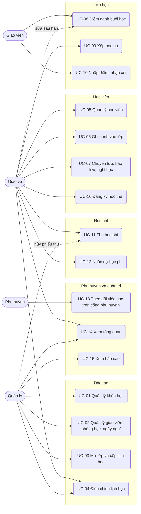
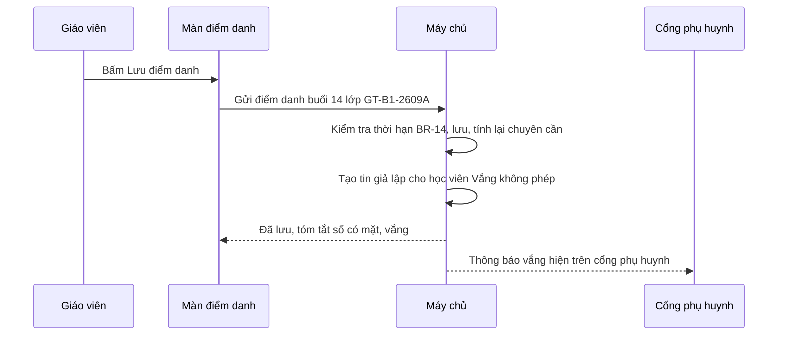

# Đặc tả use case — Quản lý Trung tâm Ngoại ngữ

> Use case phần nền (UC-SYS-01 đến UC-SYS-10): `ZDOCS/03-KIEN-TRUC/USE-CASE-NEN.md`.
> Mã FR, BR, SCR tham chiếu `02-SRS.md`.

---

## 1. Tác nhân

| Tác nhân | Mã vai trò | Use case chính |
| :--- | :--- | :--- |
| Quản lý | `MANAGER` | UC-01, UC-02, UC-03, UC-04, UC-11 (hủy phiếu thu), UC-14, UC-15 |
| Giáo vụ | `STAFF` | UC-04, UC-05, UC-06, UC-07, UC-08 (sửa sau hạn), UC-09, UC-11, UC-12, UC-14, UC-16 |
| Giáo viên | `TEACHER` | UC-08, UC-10 |
| Phụ huynh | `PARENT` | UC-13 |
| Học viên | — (không đăng nhập) | Được phục vụ qua UC-06, UC-08; học viên từ 18 tuổi dùng UC-13 bằng tài khoản `PARENT` |
| Quản trị viên | `ADMIN` | Toàn bộ, cộng phần nền |

---

## 2. Sơ đồ use case

---

## 3. Danh sách use case

| Mã | Tên | Tác nhân chính | Module | Ưu tiên | FR |
| :--- | :--- | :--- | :--- | :---: | :--- |
| UC-01 | Quản lý khóa học | Quản lý | Đào tạo | P1 | FR-03 |
| UC-02 | Quản lý giáo viên, phòng học, ngày nghỉ | Quản lý | Đào tạo | P1 | FR-04, FR-05 |
| UC-03 | Mở lớp và xếp lịch học | Quản lý | Đào tạo | P1 | FR-06, FR-07, FR-08 |
| UC-04 | Điều chỉnh lịch học | Quản lý, Giáo vụ | Đào tạo | P2 | FR-09, FR-10 |
| UC-05 | Quản lý học viên | Giáo vụ | Học viên | P1 | FR-11, FR-12, FR-13 |
| UC-06 | Ghi danh vào lớp | Giáo vụ | Học viên | P1 | FR-14 |
| UC-07 | Chuyển lớp, bảo lưu, nghỉ học | Giáo vụ | Học viên | P2 | FR-16, FR-17, FR-18 |
| UC-08 | Điểm danh buổi học | Giáo viên | Lớp học | P1 | FR-19, FR-20, FR-21, FR-33 |
| UC-09 | Xếp học bù | Giáo vụ | Lớp học | P2 | FR-22 |
| UC-10 | Nhập điểm, nhận xét | Giáo viên | Lớp học | P2 | FR-23, FR-24, FR-25 |
| UC-11 | Thu học phí | Giáo vụ | Học phí | P1 | FR-26, FR-27, FR-28, FR-29, FR-30 |
| UC-12 | Nhắc nợ học phí | Giáo vụ | Học phí | P1 | FR-31, FR-32 |
| UC-13 | Theo dõi việc học trên cổng phụ huynh | Phụ huynh | Phụ huynh và quản trị | P2 | FR-34, FR-35, FR-36 |
| UC-14 | Xem tổng quan | Quản lý, Giáo vụ | Phụ huynh và quản trị | P1 | FR-01, FR-02 |
| UC-15 | Xem báo cáo | Quản lý | Phụ huynh và quản trị | P2 | FR-37, FR-38, FR-39, FR-40 |
| UC-16 | Đăng ký học thử | Giáo vụ | Học viên | P3 | FR-15 |

---

## 4. Đặc tả chi tiết

### UC-01: Quản lý khóa học

| Mục | Nội dung |
| :--- | :--- |
| Tác nhân chính | Quản lý |
| Mô tả | Thêm, sửa, ngừng khóa học, số buổi, học phí trọn khóa và học phí tháng |
| Ưu tiên | P1 |
| Điều kiện kích hoạt | Trung tâm mở chương trình mới hoặc đổi học phí |
| Tiền điều kiện | Có quyền `courses.create` hoặc `courses.update` |
| Hậu điều kiện | Lớp mở mới và ghi danh mới dùng thông tin khóa mới; khoản học phí đã tạo giữ nguyên |
| Yêu cầu liên quan | FR-03, BR-03, BR-31 |
| Màn hình | SCR-02 |

**Luồng chính (thêm khóa học)**

1. Quản lý mở Khóa học; hệ thống hiển thị danh sách khóa: mã, tên, ngôn ngữ, số buổi, học phí trọn khóa, học phí tháng, số lớp đang mở, trạng thái.
2. Bấm "Thêm khóa học".
3. Nhập mã, tên, ngôn ngữ, trình độ, số buổi, thời lượng buổi, chọn thang điểm (thang 10 hoặc band IELTS kèm band mục tiêu).
4. Nhập học phí trọn khóa; nếu cho đóng theo tháng thì nhập học phí tháng và số buổi chuẩn mỗi tháng.
5. Nhập sĩ số tối thiểu, tối đa mặc định, mô tả.
6. Hệ thống hiển thị học phí bình quân mỗi buổi của hai hình thức để so sánh, vd trọn khóa 150.000 ₫/buổi, theo tháng 166.666 ₫/buổi.
7. Bấm "Lưu"; khóa học xuất hiện trong danh sách.

**Luồng thay thế**

- 1a. Sửa học phí: chọn khóa, đổi học phí, lưu; hệ thống thông báo "Khoản học phí đã tạo không thay đổi".
- 1b. Ngừng khóa học: tắt "Đang tuyển sinh"; không mở được lớp mới, lớp đang học vẫn chạy.

**Luồng ngoại lệ**

- E1. Mã khóa trùng: báo lỗi tại ô mã.
- E2. Số buổi ngoài 8–120, số buổi chuẩn mỗi tháng ngoài 4–16, học phí không phải bội số 1.000 ₫: báo lỗi tại ô, không lưu.
- E3. Xóa khóa đã có lớp: hệ thống từ chối, gợi ý ngừng khóa (BR-31).

### UC-02: Quản lý giáo viên, phòng học, ngày nghỉ

| Mục | Nội dung |
| :--- | :--- |
| Tác nhân chính | Quản lý |
| Mô tả | Khai báo giáo viên gắn tài khoản, phòng học và sức chứa, ngày nghỉ của trung tâm |
| Ưu tiên | P1 |
| Điều kiện kích hoạt | Có giáo viên mới, thêm phòng, chuẩn bị lịch nghỉ lễ, Tết |
| Tiền điều kiện | Có quyền `teachers.create`, `rooms.create`; tài khoản vai trò Giáo viên đã tạo (UC-SYS-05) |
| Hậu điều kiện | Giáo viên, phòng chọn được khi mở lớp; lịch học tránh ngày nghỉ |
| Yêu cầu liên quan | FR-04, FR-05, BR-01, BR-02, BR-31 |
| Màn hình | SCR-03, SCR-04 |

**Luồng chính (thêm giáo viên)**

1. Quản lý mở Giáo viên; hệ thống hiển thị danh sách: mã, họ tên, ngôn ngữ dạy, số lớp đang dạy, số giờ dạy tháng này.
2. Bấm "Thêm giáo viên", nhập họ tên, số điện thoại, ngôn ngữ dạy, chọn tài khoản đăng nhập vai trò Giáo viên chưa gắn ai.
3. Bấm "Lưu"; hệ thống cấp mã `GV` + 2 số.

**Luồng thay thế**

- 1a. Phòng học: mở Phòng học, thêm tên phòng, sức chứa.
- 1b. Ngày nghỉ (P2): mở tab Ngày nghỉ, thêm ngày và tên, vd 01/01/2027 "Tết Dương lịch". Hệ thống liệt kê các buổi chưa diễn ra rơi vào ngày đó; quản lý xác nhận thì các buổi đó và các buổi sau của lớp lùi theo lịch, ngày kết thúc dự kiến tính lại (BR-01).

**Luồng ngoại lệ**

- E1. Tài khoản đã gắn với giáo viên khác: báo lỗi tại ô tài khoản.
- E2. Giảm sức chứa phòng xuống dưới sĩ số tối đa của lớp đang dùng phòng: từ chối, liệt kê các lớp đó (BR-02).
- E3. Thêm ngày nghỉ là ngày đã qua: báo lỗi, không lưu.

### UC-03: Mở lớp và xếp lịch học

| Mục | Nội dung |
| :--- | :--- |
| Tác nhân chính | Quản lý |
| Mô tả | Mở lớp từ khóa học, chọn giáo viên, phòng, lịch; hệ thống sinh buổi học và kiểm tra trùng |
| Ưu tiên | P1 |
| Điều kiện kích hoạt | Đủ nhu cầu để mở lớp mới |
| Tiền điều kiện | Có quyền `classes.create`; khóa học đang tuyển sinh |
| Hậu điều kiện | Lớp "Đang tuyển sinh" có mã theo §5.3 và đủ buổi học; giáo vụ ghi danh được |
| Yêu cầu liên quan | FR-06, FR-07, FR-08, BR-01, BR-02, BR-04, BR-05 |
| Màn hình | SCR-05, SCR-06 |

**Luồng chính**

1. Quản lý mở Lớp học, bấm "Mở lớp".
2. Chọn khóa học; hệ thống điền sẵn sĩ số tối thiểu, tối đa của khóa.
3. Chọn giáo viên, phòng, các thứ trong tuần (vd thứ 2, 4, 6), giờ bắt đầu (vd 18:00), ngày khai giảng.
4. Hệ thống sinh mã lớp, vd `GT-B1-2610A`, và hiển thị xem trước danh sách buổi theo BR-01, ngày kết thúc dự kiến; buổi bị lùi do ngày nghỉ được đánh dấu.
5. Hệ thống kiểm tra BR-02 cho mọi buổi.
6. Quản lý bấm "Lưu"; lớp ở trạng thái "Đang tuyển sinh".

**Luồng thay thế**

- 1a. Đổi giáo viên chính hoặc phòng mặc định: áp cho các buổi chưa diễn ra, kiểm tra lại BR-02.
- 1b. Hủy lớp: lớp chưa học buổi nào, quản lý bấm "Hủy lớp", nhập lý do; hệ thống xử lý ghi danh, khoản, số dư theo BR-04.

**Luồng ngoại lệ**

- E1. Giáo viên hoặc phòng trùng giờ: báo cụ thể, vd "GV01 đã dạy IE-45-2608B thứ 4, 18:00–20:00, Phòng 202", không lưu.
- E2. Sức chứa phòng nhỏ hơn sĩ số tối đa: báo lỗi tại ô phòng.
- E3. Ngày khai giảng không rơi vào thứ đã chọn: báo "Ngày khai giảng phải là một trong các thứ học".
- E4. Lớp đã học ít nhất một buổi: nút "Hủy lớp" bị ẩn.

### UC-04: Điều chỉnh lịch học

| Mục | Nội dung |
| :--- | :--- |
| Tác nhân chính | Quản lý, Giáo vụ |
| Mô tả | Xem thời khóa biểu tuần; dời buổi, đổi phòng, giáo viên dạy thay, hủy buổi |
| Ưu tiên | P2 |
| Yêu cầu liên quan | FR-09, FR-10, BR-02 |
| Màn hình | SCR-07, SCR-06 |

**Luồng chính**

1. Mở Thời khóa biểu; hệ thống hiển thị lưới tuần, cột theo ngày, dòng theo giờ, mỗi ô là một buổi có mã lớp, phòng, giáo viên; chọn xem theo phòng hoặc theo giáo viên.
2. Bấm vào một buổi chưa diễn ra, chọn "Điều chỉnh".
3. Chọn thao tác: dời ngày giờ, đổi phòng, đặt giáo viên dạy thay, hoặc hủy buổi kèm lý do.
4. Hệ thống kiểm tra BR-02; hủy buổi thì tự thêm một buổi vào cuối lịch lớp và tính lại ngày kết thúc dự kiến.
5. Lưu; hệ thống tạo thông báo đổi lịch trên cổng phụ huynh của các học viên trong lớp.

### UC-05: Quản lý học viên

| Mục | Nội dung |
| :--- | :--- |
| Tác nhân chính | Giáo vụ |
| Mô tả | Tìm, thêm, sửa hồ sơ học viên và phụ huynh; xem toàn bộ quá trình học, học phí |
| Ưu tiên | P1 |
| Điều kiện kích hoạt | Phụ huynh đến tư vấn, học viên đổi thông tin, cần tra cứu |
| Tiền điều kiện | Có quyền `students.view`; thêm, sửa cần `students.create`, `students.update` |
| Hậu điều kiện | Hồ sơ có mã `HV` + 5 số; thay đổi ghi nhật ký |
| Yêu cầu liên quan | FR-11, FR-12, FR-13, BR-27, BR-28, BR-31 |
| Màn hình | SCR-10, SCR-11 |

**Luồng chính (thêm học viên)**

1. Giáo vụ mở Học viên; hệ thống hiển thị danh sách có ô tìm theo mã, họ tên, số điện thoại học viên hoặc phụ huynh, lọc theo lớp, trạng thái.
2. Bấm "Thêm học viên", nhập họ tên, ngày sinh, giới tính, số điện thoại, trường đang học, nguồn biết đến (Facebook, Người quen giới thiệu, Đi ngang qua, Khác), ghi chú.
3. Nhập phụ huynh: họ tên, quan hệ, số điện thoại (tối đa 2 người).
4. Bấm "Lưu"; hệ thống kiểm tra BR-27, BR-28, cấp mã học viên, mở hồ sơ chi tiết.

**Luồng thay thế**

- 1a. Xem hồ sơ chi tiết: các tab Thông tin, Lớp học (ghi danh, chuyên cần), Kết quả (điểm, nhận xét), Học phí (khoản, phiếu thu, số dư), Lịch sử (chuyển lớp, bảo lưu, nhắc nợ).
- 1b. Sửa hồ sơ: bấm "Sửa", đổi thông tin, lưu.
- 1c. Gắn tài khoản cổng phụ huynh: ở phụ huynh, chọn tài khoản vai trò Phụ huynh (tạo ở UC-SYS-05); tài khoản đó thấy học viên này trên cổng.

**Luồng ngoại lệ**

- E1. Số điện thoại sai định dạng: báo lỗi tại ô.
- E2. Học viên dưới 18 tuổi chưa có phụ huynh có số điện thoại: báo "Học viên dưới 18 tuổi cần ít nhất một phụ huynh", không lưu.
- E3. Trùng họ tên và ngày sinh: hộp "Có thể trùng học viên" liệt kê hồ sơ khớp; chọn "Dùng hồ sơ này" hoặc "Vẫn tạo mới".
- E4. Trùng số điện thoại phụ huynh: hiện gợi ý "Có thể là anh chị em của HV00126 Trần Bảo Ngọc", không chặn lưu.
- E5. Gắn tài khoản phụ huynh thứ ba: báo lỗi, tối đa 2 tài khoản (BR-27).

### UC-06: Ghi danh vào lớp

| Mục | Nội dung |
| :--- | :--- |
| Tác nhân chính | Giáo vụ |
| Mô tả | Xếp học viên vào lớp, chọn hình thức học phí, ưu đãi; hệ thống tính học phí và tạo khoản |
| Ưu tiên | P1 |
| Điều kiện kích hoạt | Phụ huynh đồng ý cho con học sau khi tư vấn |
| Tiền điều kiện | Có quyền `enrollments.create`; học viên đã có hồ sơ; có lớp "Đang tuyển sinh" hoặc "Đang học" còn chỗ |
| Hậu điều kiện | Ghi danh "Chờ học" hoặc "Đang học" có mã theo §5.3; khoản học phí được tạo; sĩ số lớp tăng 1 |
| Yêu cầu liên quan | FR-14, BR-05, BR-06, BR-07, BR-08, BR-09, BR-28, BR-30 |
| Màn hình | SCR-11, SCR-06 |

**Luồng chính**

1. Từ hồ sơ học viên, giáo vụ bấm "Ghi danh".
2. Chọn khóa học; hệ thống liệt kê lớp "Đang tuyển sinh" và "Đang học": mã lớp, lịch, giáo viên, sĩ số / tối đa, buổi kế tiếp; lớp đầy hiện mờ.
3. Chọn lớp, chọn buổi bắt đầu học (mặc định buổi hôm nay hoặc buổi kế tiếp chưa diễn ra).
4. Chọn hình thức học phí: trọn khóa, hoặc theo tháng nếu khóa có học phí tháng.
5. Chọn ưu đãi; hệ thống tự gợi ý "Anh chị em ruột" nếu khớp BR-28.
6. Hệ thống hiển thị bảng tính: trọn khóa thì F × số buổi tính phí / N, tiền giảm, phải thu, hạn đóng; theo tháng thì khoản tháng đầu theo BR-07, tiền giảm, phải thu, hạn đóng.
7. Bấm "Xác nhận ghi danh"; hệ thống tạo ghi danh, khoản học phí, tăng sĩ số và gợi ý "Thu tiền ngay" (UC-11).

**Luồng thay thế**

- 1a. Ghi danh từ lớp: mở chi tiết lớp, tab Học viên, bấm "Thêm học viên", tìm học viên, tiếp tục bước 3.
- 7a. Thu ngay: bấm "Thu tiền ngay", hệ thống mở phiếu thu với khoản vừa tạo (UC-11).

**Luồng ngoại lệ**

- E1. Lớp đã đủ sĩ số tối đa: không chọn được.
- E2. Học viên đã ghi danh lớp này: báo "Học viên đã có trong lớp".
- E3. Trùng giờ với lớp khác học viên đang học: cảnh báo, giáo vụ vẫn xác nhận được.
- E4. Khóa không có học phí tháng: chỉ hiện hình thức trọn khóa.
- E5. Chọn buổi bắt đầu đã diễn ra: không chọn được (BR-30).

### UC-07: Chuyển lớp, bảo lưu, nghỉ học

| Mục | Nội dung |
| :--- | :--- |
| Tác nhân chính | Giáo vụ |
| Mô tả | Xử lý học viên đổi lịch học, tạm dừng hoặc thôi học, tính tiền chênh lệch |
| Ưu tiên | P2 |
| Yêu cầu liên quan | FR-16, FR-17, FR-18, BR-22, BR-23, BR-24 |
| Màn hình | SCR-11 |

**Luồng chính (chuyển lớp)**

1. Giáo vụ mở hồ sơ học viên, tab Lớp học, chọn ghi danh, bấm "Chuyển lớp".
2. Chọn lớp mới (cùng khóa hoặc khác khóa); hệ thống chỉ liệt kê lớp còn chỗ.
3. Hệ thống hiển thị: số buổi đã học, giá trị còn lại, học phí lớp mới, chênh lệch (BR-22).
4. Bấm "Xác nhận"; ghi danh cũ "Đã chuyển lớp", tạo ghi danh mới; chênh lệch dương tạo khoản thu thêm, âm cộng vào số dư.

**Luồng chính (bảo lưu và học tiếp)**

1. Chọn ghi danh trọn khóa đã đóng đủ, bấm "Bảo lưu", chọn ngày bắt đầu bảo lưu, lý do.
2. Hệ thống hiển thị số buổi chưa học, giá trị bảo lưu, hạn bảo lưu 180 ngày (BR-23); xác nhận thì học viên rời lớp.
3. Khi học viên quay lại, giáo vụ bấm "Học tiếp", chọn lớp cùng khóa và buổi bắt đầu; hệ thống trừ giá trị bảo lưu vào học phí lớp mới, xử lý chênh lệch như chuyển lớp.

**Luồng chính (nghỉ học)**

1. Chọn ghi danh, bấm "Nghỉ học", chọn ngày, lý do.
2. Hệ thống hiển thị các khoản sẽ hủy và khoản vẫn còn nợ (BR-24); xác nhận thì ghi danh "Đã nghỉ".

### UC-08: Điểm danh buổi học

| Mục | Nội dung |
| :--- | :--- |
| Tác nhân chính | Giáo viên |
| Tác nhân phụ | Giáo vụ (sửa sau hạn), Phụ huynh (nhận thông báo) |
| Mô tả | Giáo viên điểm danh trên điện thoại, ghi bài học, bài tập; hệ thống báo phụ huynh khi vắng |
| Ưu tiên | P1 |
| Điều kiện kích hoạt | Đầu hoặc trong buổi học |
| Tiền điều kiện | Có quyền `attendances.take`; giáo viên dạy buổi đó; trong thời hạn BR-14 |
| Hậu điều kiện | Buổi "Đã điểm danh"; chuyên cần học viên cập nhật; tin vắng được tạo |
| Yêu cầu liên quan | FR-19, FR-20, FR-21, FR-33, BR-14, BR-15, BR-17, BR-19, BR-26 |
| Màn hình | SCR-05, SCR-08 |

**Luồng chính**

1. Giáo viên đăng nhập trên điện thoại; trang Lớp học hiện "Buổi dạy hôm nay": giờ, mã lớp, phòng, sĩ số.
2. Chọn buổi; hệ thống hiển thị danh sách học viên, mặc định "Có mặt", kèm nhãn Học bù, Học thử, Xin nghỉ, Cần gặp giáo vụ; học viên đã xin nghỉ hiện sẵn "Vắng có phép" (BR-19).
3. Giáo viên chạm vào học viên để đổi sang Đi muộn, Vắng có phép hoặc Vắng không phép, nhập ghi chú nếu cần.
4. Nhập nội dung bài học và bài tập về nhà.
5. Bấm "Lưu điểm danh"; hệ thống lưu, đánh dấu buổi đã điểm danh, tạo tin vắng theo BR-17 và hiển thị tóm tắt, vd "Có mặt 12, Đi muộn 1, Vắng 2".

**Luồng thay thế**

- 3a. Bấm "Tất cả có mặt" để đặt lại mọi học viên về Có mặt.
- 5a. Sửa trong hạn: mở lại buổi, sửa, lưu; tin vắng đã tạo không bị thu hồi.
- 1a. Giáo vụ sửa sau hạn (P2): mở chi tiết lớp, tab Buổi học, chọn buổi, sửa điểm danh, nhập lý do; hệ thống ghi nhật ký.

**Luồng ngoại lệ**

- E1. Ngoài thời hạn: nút lưu bị khóa, hiện "Chưa tới giờ điểm danh" (sớm hơn 15 phút) hoặc "Đã hết hạn điểm danh, liên hệ giáo vụ" (quá 24 giờ).
- E2. Giáo viên mở buổi của lớp không dạy: không có trong danh sách; vào thẳng URL bị chuyển tới `/forbidden`.
- E3. Mất kết nối khi lưu (chế độ `api`): giữ nguyên lựa chọn, báo "Chưa lưu được, thử lại", lưu lại không tạo trùng (NFR-03).

### UC-09: Xếp học bù

| Mục | Nội dung |
| :--- | :--- |
| Tác nhân chính | Giáo vụ |
| Mô tả | Xếp học viên vắng có phép học buổi tương ứng ở lớp khác cùng khóa |
| Ưu tiên | P2 |
| Yêu cầu liên quan | FR-22, BR-15, BR-16, BR-18 |
| Màn hình | SCR-11, SCR-08 |

**Luồng chính**

1. Giáo vụ mở hồ sơ học viên, tab Lớp học; các buổi "Vắng có phép" chưa học bù có nút "Xếp học bù".
2. Bấm "Xếp học bù"; hệ thống liệt kê buổi phù hợp theo BR-18: lớp, buổi số, ngày giờ, phòng, chỗ còn trống.
3. Chọn buổi, bấm "Xác nhận"; học viên xuất hiện trong danh sách điểm danh buổi đó với nhãn "Học bù"; phụ huynh thấy lịch học bù trên cổng.
4. Khi giáo viên lớp đó điểm danh học viên có mặt, buổi vắng gốc chuyển "Đã học bù" và được tính vào chuyên cần (BR-16).

### UC-10: Nhập điểm, nhận xét

| Mục | Nội dung |
| :--- | :--- |
| Tác nhân chính | Giáo viên |
| Mô tả | Nhập điểm bài kiểm tra, viết nhận xét tháng, xét kết quả cuối khóa |
| Ưu tiên | P2 |
| Yêu cầu liên quan | FR-23, FR-24, FR-25, BR-16, BR-20, BR-21 |
| Màn hình | SCR-09 |

**Luồng chính**

1. Giáo viên mở lớp, tab Điểm và nhận xét.
2. Bấm "Thêm bài kiểm tra", chọn loại (thường xuyên, giữa khóa, cuối khóa), ngày; nhập điểm từng học viên theo thang của khóa (BR-20); lưu.
3. Cuối tháng, mở mục Nhận xét tháng; với mỗi học viên chấm 5 tiêu chí 1–5 sao, viết lời nhận xét; bấm "Gửi" để phụ huynh thấy (BR-21).
4. Sau buổi cuối, hệ thống tính kết quả cuối khóa và chuyên cần, hiển thị Đạt hoặc Chưa đạt; giáo vụ in phiếu kết quả học tập khổ A4.

### UC-11: Thu học phí

| Mục | Nội dung |
| :--- | :--- |
| Tác nhân chính | Giáo vụ |
| Tác nhân phụ | Quản lý (hủy phiếu thu) |
| Mô tả | Thu học phí một hoặc nhiều khoản, thu một phần, trừ số dư, in phiếu thu |
| Ưu tiên | P1 |
| Điều kiện kích hoạt | Phụ huynh đến quầy đóng học phí hoặc báo đã chuyển khoản |
| Tiền điều kiện | Có quyền `receipts.create`; học viên có khoản còn nợ |
| Hậu điều kiện | Phiếu thu có mã theo §5.3; số đã đóng và trạng thái các khoản cập nhật theo BR-10 |
| Yêu cầu liên quan | FR-26, FR-27, FR-28, FR-29, FR-30, BR-09, BR-10, BR-11, BR-12, BR-13 |
| Màn hình | SCR-12, SCR-13 |

**Luồng chính (thu tiền mặt)**

1. Giáo vụ mở Học phí, tìm học viên theo tên, mã hoặc số điện thoại phụ huynh; hệ thống hiển thị các khoản còn nợ theo hạn đóng, nhãn "Quá hạn" nếu có, số dư của học viên.
2. Chọn khoản cần thu (mặc định mọi khoản còn nợ).
3. Hệ thống điền số tiền bằng tổng còn nợ các khoản đã chọn và xem trước phân bổ theo BR-11.
4. Chọn "Tiền mặt", nhập tiền khách đưa; hệ thống hiển thị tiền thối (BR-12).
5. Bấm "Hoàn tất"; hệ thống tạo phiếu thu, cập nhật các khoản, mở bản in A5 gồm tên trung tâm, mã phiếu, học viên, lớp, từng khoản và số tiền phân bổ, tổng tiền bằng số và bằng chữ, phương thức, người thu.

**Luồng thay thế**

- 3a. Thu một phần: giáo vụ sửa số tiền nhỏ hơn tổng còn nợ; hệ thống phân bổ khoản hạn sớm nhất trước và hiển thị khoản nào còn nợ bao nhiêu.
- 3b. Trừ số dư: tick "Trừ số dư"; hệ thống trừ số dư trước, số tiền cần thu giảm tương ứng.
- 4a. Chuyển khoản: hệ thống hiển thị QR giả lập có số tiền, nội dung là mã phiếu thu dự kiến; giáo vụ bấm "Đã nhận tiền".
- 4b. Thẻ: chọn "Thẻ"; hệ thống chỉ ghi nhận phương thức, không nhập số thẻ.
- 1a. Khoản tháng tự tạo: ngày 1 hằng tháng hệ thống tạo khoản tháng cho mọi ghi danh theo tháng đang học (BR-07, BR-09); giáo vụ thấy trong danh sách khoản.
- 1b. Hủy phiếu thu (P2): quản lý mở phiếu thu lập trong tháng này, bấm "Hủy", nhập lý do; các khoản trừ lại số đã phân bổ (BR-13).

**Luồng ngoại lệ**

- E1. Tiền khách đưa nhỏ hơn số tiền thu: nút "Hoàn tất" bị khóa, hiện "Còn thiếu {số tiền}".
- E2. Số tiền thu lớn hơn tổng còn nợ các khoản đã chọn: báo "Số tiền tối đa {tổng còn nợ}".
- E3. Bấm "Hoàn tất" hai lần liên tiếp (chế độ `api`): chỉ một phiếu thu được tạo.
- E4. Phiếu thu của tháng trước hoặc người dùng không có quyền `receipts.cancel`: nút "Hủy" bị ẩn.

### UC-12: Nhắc nợ học phí

| Mục | Nội dung |
| :--- | :--- |
| Tác nhân chính | Giáo vụ |
| Mô tả | Theo dõi khoản quá hạn và sắp đến hạn, gửi tin nhắc giả lập, ghi kết quả gọi điện |
| Ưu tiên | P1 |
| Điều kiện kích hoạt | Đầu tuần hoặc sau ngày 10 hằng tháng |
| Tiền điều kiện | Có quyền `debts.view`, `debts.remind` |
| Hậu điều kiện | Lần nhắc được ghi vào lịch sử học viên; tin giả lập hiện trên cổng phụ huynh |
| Yêu cầu liên quan | FR-31, FR-32, BR-09, BR-25, BR-26 |
| Màn hình | SCR-14 |

**Luồng chính**

1. Giáo vụ mở Nhắc nợ; hệ thống hiển thị danh sách theo học viên: phụ huynh, lớp, khoản, số còn nợ, số ngày quá hạn (đỏ khi quá 15 ngày), lần nhắc gần nhất, ngày hẹn đóng; sắp theo số ngày quá hạn giảm dần.
2. Lọc theo lớp hoặc mức: đến hạn trong 3 ngày, quá hạn 1–15 ngày, 16–30 ngày, trên 30 ngày.
3. Chọn học viên, bấm "Gửi tin nhắc"; hệ thống tạo tin giả lập theo mẫu BR-25, hiển thị nội dung, ghi lần nhắc.
4. Giáo vụ gọi điện cho phụ huynh, bấm "Ghi kết quả": Hẹn đóng (chọn ngày), Không nghe máy, Xin gia hạn, Khác; nhập ghi chú.
5. Dòng cập nhật lần nhắc gần nhất và ngày hẹn đóng; quá ngày hẹn mà chưa đóng thì hiện nhãn cam "Lỡ hẹn đóng".

**Luồng thay thế**

- 3a. Gửi hàng loạt: chọn nhiều học viên, bấm "Gửi tin nhắc"; học viên đã được nhắc trong 3 ngày bị bỏ qua, hệ thống báo số tin đã tạo và số bị bỏ qua.
- 4a. Phụ huynh đến đóng ngay: bấm "Thu tiền", mở phiếu thu (UC-11).

**Luồng ngoại lệ**

- E1. Học viên đã được nhắc trong 3 ngày: nút gửi bị khóa, chú thích "Đã nhắc ngày dd/MM, gửi lại từ ngày dd/MM".
- E2. Học viên và phụ huynh không có số điện thoại: không tạo tin, chỉ ghi kết quả.

### UC-13: Theo dõi việc học trên cổng phụ huynh

| Mục | Nội dung |
| :--- | :--- |
| Tác nhân chính | Phụ huynh |
| Mô tả | Xem lịch học, điểm danh, bài tập, điểm, nhận xét, học phí của con; gửi xin nghỉ |
| Ưu tiên | P2 |
| Yêu cầu liên quan | FR-34, FR-35, FR-36, BR-19, BR-27 |
| Màn hình | SCR-15 |

**Luồng chính**

1. Phụ huynh đăng nhập trên điện thoại; hệ thống mở Cổng phụ huynh, chọn sẵn con đầu tiên, có nút đổi con.
2. Màn đầu hiển thị: lịch học tuần này, chuyên cần, số học phí còn nợ, thông báo mới (vắng học, đổi lịch, nhắc nợ).
3. Phụ huynh mở tab Điểm danh để xem từng buổi và bài tập về nhà; tab Kết quả để xem điểm và nhận xét tháng đã gửi.
4. Mở tab Học phí: các khoản, đã đóng, còn nợ, hạn đóng, QR chuyển khoản giả lập, lịch sử phiếu thu.
5. Muốn xin nghỉ, phụ huynh chọn buổi sắp tới, nhập lý do, bấm "Gửi" (BR-19); buổi đó hiện "Đã xin nghỉ".

### UC-14: Xem tổng quan

| Mục | Nội dung |
| :--- | :--- |
| Tác nhân chính | Quản lý, Giáo vụ |
| Mô tả | Nắm nhanh tình hình trung tâm hôm nay: học viên, lớp, buổi học, tiền thu, nợ |
| Ưu tiên | P1 |
| Điều kiện kích hoạt | Đăng nhập hoặc mở Tổng quan |
| Tiền điều kiện | Có quyền `dashboard.view` |
| Hậu điều kiện | Không thay đổi dữ liệu |
| Yêu cầu liên quan | FR-01, FR-02, BR-05, BR-16, BR-29 |
| Màn hình | SCR-01 |

**Luồng chính**

1. Người dùng đăng nhập; hệ thống mở Tổng quan.
2. Hiển thị 6 thẻ số: học viên đang học, lớp đang học, buổi học hôm nay, thực thu tháng này, tổng nợ quá hạn, chuyên cần 30 ngày.
3. Hiển thị danh sách buổi học hôm nay theo giờ; buổi đã qua giờ kết thúc mà chưa điểm danh tô vàng (P2).
4. Hiển thị lớp sắp khai giảng thiếu sĩ số tối thiểu (P2).

**Luồng thay thế**

- 2a. Bấm thẻ "Nợ quá hạn": mở Nhắc nợ lọc sẵn quá hạn.
- 3a. Bấm một buổi: mở chi tiết lớp.

**Luồng ngoại lệ**

- E1. Hôm nay không có buổi học: hiển thị "Hôm nay không có buổi học", các thẻ khác vẫn có số liệu.
- E2. Giáo viên, phụ huynh không có quyền `dashboard.view`: giáo viên vào thẳng Lớp học, phụ huynh vào thẳng Cổng phụ huynh.

### UC-15: Xem báo cáo

| Mục | Nội dung |
| :--- | :--- |
| Tác nhân chính | Quản lý |
| Mô tả | Phân tích thực thu, công nợ, lớp học, biến động học viên, giờ dạy |
| Ưu tiên | P2 |
| Yêu cầu liên quan | FR-37, FR-38, FR-39, FR-40, BR-16, BR-29 |
| Màn hình | SCR-16 |

**Luồng chính**

1. Quản lý mở Báo cáo; mặc định tab Thực thu, 6 tháng gần nhất.
2. Hệ thống hiển thị biểu đồ cột thực thu theo tháng, bảng theo khóa học và phương thức.
3. Quản lý chuyển sang tab Công nợ, Lớp học, Biến động học viên, Giờ dạy giáo viên, Phiếu thu đã hủy; đổi khoảng thời gian, khóa, lớp.
4. Bấm "Xuất Excel" để tải báo cáo đang xem (P3).
